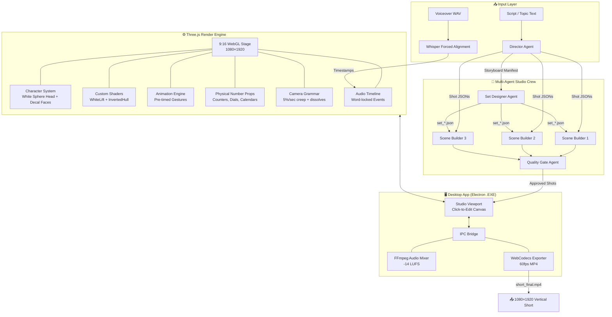
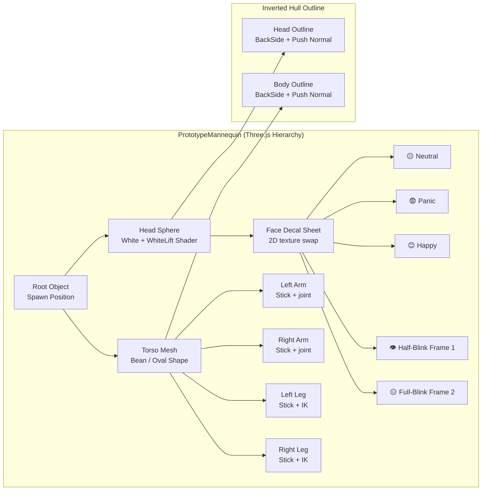
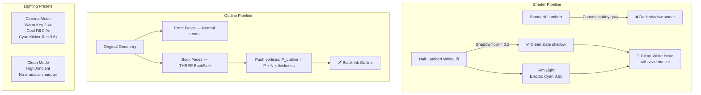
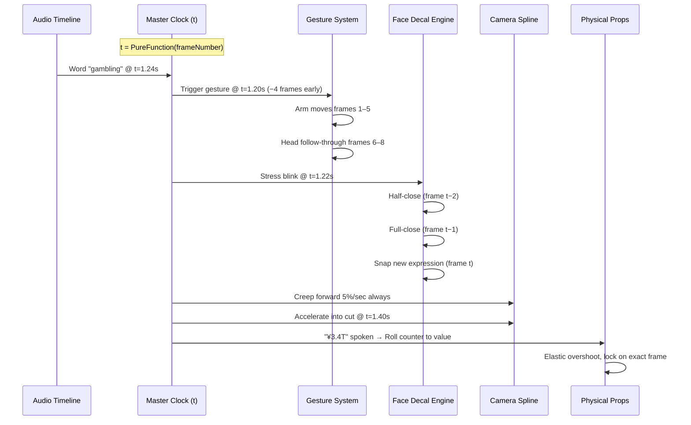
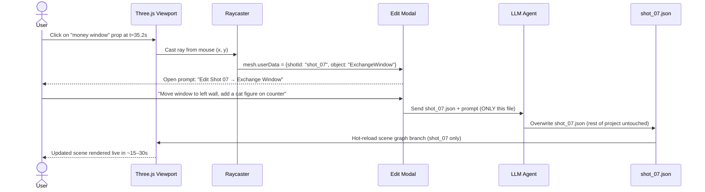

# 🎬 ShortStudio Engine — Complete Architecture & Visual Analysis

> **Target Output**: 9:16 vertical explainer shorts in the exact visual style of the reference video.

---

## 🎥 Reference Video Analysis — "The Window That Breaks Japan's Gambling Law"

### Visual Style DNA (extracted from 9 frames)

````carousel

<!-- slide -->

<!-- slide -->

<!-- slide -->

<!-- slide -->

<!-- slide -->

<!-- slide -->

<!-- slide -->

<!-- slide -->

````

---

### 🎨 Extracted Visual Style Rules

| Property | Specification |
|:---|:---|
| **Aspect Ratio** | 9:16 vertical (1080×1920) |
| **Format** | 45 seconds @ 30fps |
| **Character Style** | Chibi/cartoon stickmen with **large white sphere heads**, small 2D decal faces drawn in bold ink lines, simple bean/oval torso, stick limbs |
| **Character Outlines** | **Bold black ink outlines** (inverted-hull method) — gives a 2D-drawn look on 3D objects |
| **Color – Characters** | Pure white heads; saturated body colors (orange, purple/blue, black, red, teal) matching role/personality |
| **Face Style** | **2D decals** on 3D sphere: bold circle eyes, dot pupils, simple arc mouth, optional glasses/sunglasses |
| **Backgrounds** | **3D-rendered environments** with high production detail — neon-lit Japanese streets, pachinko halls, prize counters, alleyways |
| **Bg Lighting** | Dramatic cinematic — warm orange interior glows, cool blue/purple night exteriors, pink/magenta neon signs |
| **Bg Depth of Field** | Foreground elements slightly bokeh'd, main characters sharp |
| **Caption Style** | White bold text, black stroke, centered, lower 30% of screen |
| **Signage** | Mix of English + Japanese (katakana/kanji) — adds authenticity |
| **Color Palette** | Deep navy blue nights, warm amber interiors, hot pink/magenta neon, yellow/orange signage, red patterned carpet |
| **Scene density** | ~1.1 seconds per shot, extremely fast cuts |
| **Transitions** | Smooth cross-dissolves, camera pushes through doorways |
| **Camera** | Constant slow creep forward, dynamic angles, wide establishing → close up |

---

## 🏗️ System Architecture

### High-Level Overview



---

### 🎭 Character Architecture



---

### 📦 Project File Structure

```
projects/
└── pachinko_loophole/
    ├── project.json              # Master: timestamps, word-map, FPS, shot list
    ├── sets/
    │   ├── pachinko_street.json  # Neon Japanese street — used shots 01, 06, 08
    │   ├── pachinko_hall.json    # Hall interior — used shots 02, 03
    │   ├── prize_counter.json    # Counter interior — used shots 04, 05
    │   └── exchange_window.json  # Back-alley window — used shots 07, 09
    ├── shots/
    │   ├── shot_01.json          # Hook — street + enter pachinko
    │   ├── shot_02.json          # Hall row of machines
    │   ├── shot_03.json          # Prize hall exterior / cop
    │   ├── shot_04.json          # Prize counter — trading balls for snacks
    │   ├── shot_05.json          # Close-up exchange (smiling)
    │   ├── shot_06.json          # Alley — middle-man concept
    │   ├── shot_07.json          # Sliding money window
    │   ├── shot_08.json          # Wide street — group of chars
    │   └── shot_09.json          # Final close-up / pay-off
    └── audio/
        ├── voiceover_tight.wav   # Silences clamped to ≤0.2s
        ├── alignment.json        # Whisper word timestamps
        ├── sfx_manifest.json     # Sound effect cues (−10 LU hits, −15 LU whooshes)
        └── music_bed.wav         # −18 LU background track
```

---

### 🎨 Shader & Material Pipeline



---

### ⏱️ Animation Timing System



---

## 🚀 Implementation Roadmap (6 Phases)

### Phase Status Overview

```
Phase 1: Foundation [COMPLETED ✅]
  ├─ 9:16 Stage (1080×1920)
  ├─ WhiteLift Shader (Half-Lambert)
  ├─ InvertedHull Ink Outlines
  ├─ 70% Caption Safe Zone overlay
  ├─ Cinema + Clean lighting presets
  └─ PrototypeMannequin (head+body+limbs+blink)

Phase 2: Rigging & Gestures [TODO]
  ├─ Joint hierarchy (head, torso, clavicles, elbows, wrists, hips, knees)
  ├─ Rigid hold clamp (<0.5px drift)
  ├─ Pre-timed gestures (-3 to -5 frames early)
  ├─ Head follow-through lag (2–4 frames)
  ├─ Walk cycle (step every 5–6 frames, 7% head-height bob)
  └─ Jolt/shock action (50% head height in 2 frames)

Phase 3: Physical Number Objects [TODO]
  ├─ RollingCounterMesh (0–9 with elastic stop)
  ├─ DialGaugeMesh (needle, 10% spring overshoot)
  ├─ FlipCalendarMesh (hinged top fold)
  ├─ SweepingClockMesh (hands whirl to target time)
  └─ MagnifyingGlassMesh (slides over document)

Phase 4: Forced Audio Alignment [TODO]
  ├─ Whisper CTC integration (20ms word boundaries)
  ├─ Silence clamping ≤0.2s
  ├─ Word timestamp → frame number mapper
  └─ Master clock: Scene(t) = PureFunction(t)

Phase 5: Desktop EXE + Click-to-Edit [TODO]
  ├─ Electron shell (main.cjs + preload.cjs)
  ├─ Three.js raycaster → mesh.userData → modal
  ├─ Prompt mutation engine (shot_XX.json only)
  ├─ Glowing selection box on picked object
  └─ Scene graph hot-reload (branch only)

Phase 6: Export & Sound [TODO]
  ├─ WebCodecs 60fps 1080×1920 MP4 capture
  ├─ FFmpeg multi-track mixer (-10/-15/-18 LU)
  ├─ Master bus: -14 LUFS (YouTube/TikTok standard)
  └─ electron-builder → ShortStudio-Setup.exe
```

---

## 📐 The 6 Mathematical Animation Rules (Implementation Reference)

| Rule | Key Numbers | Implementation |
|:---|:---|:---|
| **Rule 1: Holds** | `<0.5px/frame` drift | Clamp position delta per frame in animation loop |
| **Rule 2: Gesture Timing** | Land **-3 to -5 frames** before word | `gestureFrame = wordFrame - 4` |
| **Rule 2b: Head Lag** | 2–4 frames after hand stops | Separate head rotation easing that trails hand |
| **Rule 3: Blink** | 2-frame close, snap new expression | Decal texture swap at `[t-2, t-1, t]` frames |
| **Rule 4: Camera Creep** | 5%/sec zoom, no handheld noise | Bezier spline, add `scale *= 1 + 0.05 * dt` |
| **Rule 5: Dissolves** | 6 frames (0.2s) | Cross-fade opacity on both scenes simultaneously |
| **Rule 6: Physical Facts** | Reach value on exact spoken frame | Elastic damping: `v += (target-v)*spring; v*=damping` |

---

## 🔊 Sound Engineering Matrix

```
LOUDNESS REFERENCE (relative to voiceover = 0.0 LU)
━━━━━━━━━━━━━━━━━━━━━━━━━━━━━━━━━━━━━━━━━━━━━━━━
  0.0 LU  ███████████████████████████  VOICEOVER (Anchor)
─10.0 LU  ██████████████░░░░░░░░░░░░░  Physical Impacts (counters, steps)
─15.0 LU  ████████░░░░░░░░░░░░░░░░░░░  Whooshes, Camera Zooms, Page Flips
─18.0 LU  ██████░░░░░░░░░░░░░░░░░░░░░  Music Bed (NO DUCKING)
━━━━━━━━━━━━━━━━━━━━━━━━━━━━━━━━━━━━━━━━━━━━━━━━
  Master Bus Target: -14 LUFS (YouTube Shorts / TikTok)
  Hit Density: 12–20 SFX/minute
```

---

## 🖱️ Click-to-Edit Flow



---

## 🧪 Quality Gate Checks

| Check | Failure Condition | Auto-Fix |
|:---|:---|:---|
| Caption Occlusion | Face Y-projection > 70% screen | Camera tilts up / pans |
| Object Occlusion | Raycast hits prop before head | Camera shifts laterally along arc |
| Furniture Clipping | Hips penetrate seat volume | Clamp pelvis to seat front edge |
| Foot Sliding | Stance foot drifts >0.5mm/frame | IK locks foot bone during contact |
| Black Smear | Broken normals + bloom | Normal repair pass pre-postprocess |
| Head Cropping | Close-up cuts eyes | Camera crops scalp/hair, NEVER eyes |

---

## 🗂️ Technology Stack

| Layer | Technology | Purpose |
|:---|:---|:---|
| **Render Engine** | Three.js (WebGL) | 3D scene, characters, shaders |
| **Desktop Shell** | Electron / Tauri | Native .exe packaging, IPC |
| **Audio Alignment** | Whisper CTC (local) | 20ms word timestamps |
| **Video Export** | WebCodecs + mp4-muxer | 60fps 1080×1920 MP4 |
| **Audio Mix** | FFmpeg (local) | Multi-track loudness mixing |
| **AI Agents** | Claude Code / Gemini (local CLI) | Script → shots, click-to-edit |
| **Package** | electron-builder | ShortStudio-Setup.exe |
| **Dev Server** | Vite | HMR for fast iteration |

---

## 🎯 Key Differentiators vs. Standard AI Video Tools

| Feature | Standard AI Video | ShortStudio Engine |
|:---|:---|:---|
| Idle motion | Breathing, swaying | **DEAD STILL** (<0.5px/frame) |
| Gesture timing | Lands on/after word | **Pre-lands 3–5 frames BEFORE** |
| Faces | Lip-sync / blendshapes | **2-frame blink snap + decal** |
| Camera | Static or shaky | **Constant 5%/sec deterministic creep** |
| Numbers | Text overlay | **Physical 3D prop (rolling counter)** |
| Transitions | Hard cuts | **6-frame (0.2s) cross-dissolves** |
| Edit workflow | Regenerate everything | **Click object → edit 1 JSON → hot-reload** |
| Rendering | Cloud / GPU farm | **Local WebCodecs, zero API cost** |
